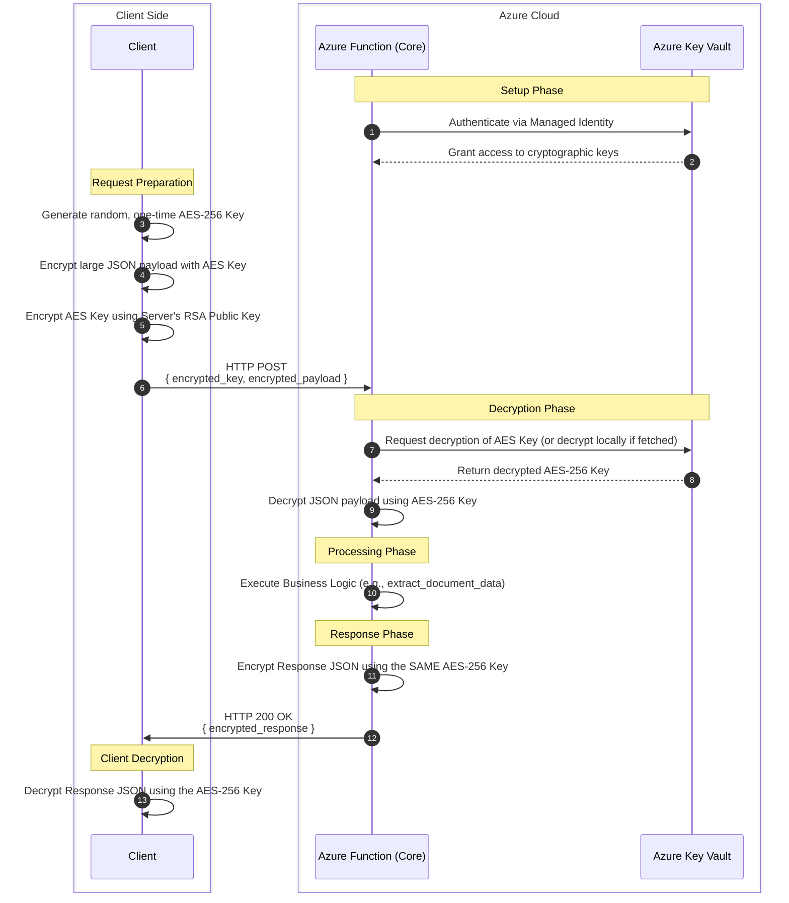

# Hybrid Payload Encryption Architecture

This document outlines the architecture for implementing **Hybrid Encryption (RSA + AES)** for API payloads in the BotIQ platform. This approach ensures End-to-End Encryption (E2EE) for sensitive document data, utilizing **Azure Key Vault** for secure key management.

## 1. Overview

The Hybrid approach combines the speed of Symmetric encryption (AES) with the secure key-exchange capabilities of Asymmetric encryption (RSA). 

Because RSA is too slow and has size limits for encrypting large payloads (like base64 PDFs or large JSONs), we only use RSA to encrypt a lightweight, one-time "session key". The heavy lifting of encrypting the actual payload is done by the fast AES algorithm.

## 2. Role of Azure Key Vault

**Azure Key Vault** is critical in this architecture for securing the server's Private Key. You have two options for integrating Key Vault:

1. **Key Fetching (Faster, Less Secure):** The Azure Function authenticates with Key Vault on startup, downloads the RSA Private Key into memory, and performs decryption locally. 
2. **Cryptographic Operations API (Highly Secure, Slower):** The RSA Private Key *never* leaves Key Vault. The Azure Function sends the `encrypted_aes_key` to Key Vault, and Key Vault returns the decrypted AES key. This guarantees the private key is never exposed in the application memory.

*Recommendation: For document processing, Option 1 is usually sufficient if the Azure Function environment is secure. Option 2 is best for highly regulated (e.g., banking/healthcare) environments.*

## 3. Data Flow Diagram

Below is a sequence diagram illustrating the step-by-step data flow from the client to the server and back.



## 4. Payload Structure Example

Your API request and response bodies will change from plain JSON to an encrypted envelope structure.

**Original Request:**
```json
{
  "key": "api_key_123",
  "input_file": "base64_string...",
  "request_model": "extract_v1"
}
```

**Encrypted Request (Hybrid Envelope):**
```json
{
  "encrypted_key": "base64_encoded_RSA_encrypted_AES_key",
  "iv": "base64_encoded_initialization_vector",
  "encrypted_payload": "base64_encoded_AES_encrypted_data",
  "auth_tag": "base64_encoded_GCM_auth_tag"
}
```

## 5. Implementation Roadmap

If you choose to adopt this, here are the steps required for your `core-prod` repository:

1. **Key Generation:** Generate an RSA-2048 or RSA-4096 key pair. Upload the Private Key to Azure Key Vault and distribute the Public Key to your clients.
2. **Library Installation:** Add the `cryptography` package to your `requirements.txt`. (Note: You already have `azure-keyvault-secrets`, you may also need `azure-keyvault-keys`).
3. **Middleware / Decorator:** Create a Python decorator (e.g., `@require_encryption`) in your `common_functions` folder. This decorator will intercept incoming requests, perform the decryption logic using Key Vault, and pass the decrypted JSON to your main function.
4. **Response Wrapper:** Modify the `utils.f_generate_response` function to optionally accept the symmetric AES key and encrypt the final payload before returning the `func.HttpResponse`.
5. **Client Updates:** All clients calling the BotIQ API must be updated to implement the encryption logic before sending requests.

> [!TIP]
> **Performance Tip:** Using Azure Key Vault's API for every single request decryption (Option 2) will add network latency to your API calls. If high throughput is required, consider fetching the Private Key at Function app startup and caching it in memory (Option 1), provided your runtime environment is strictly controlled.
